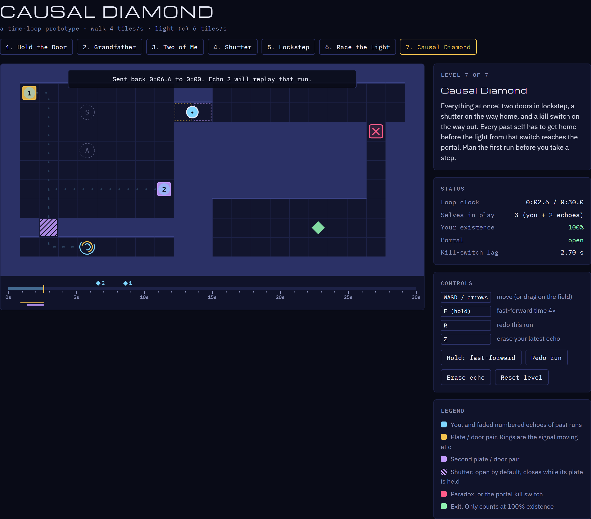
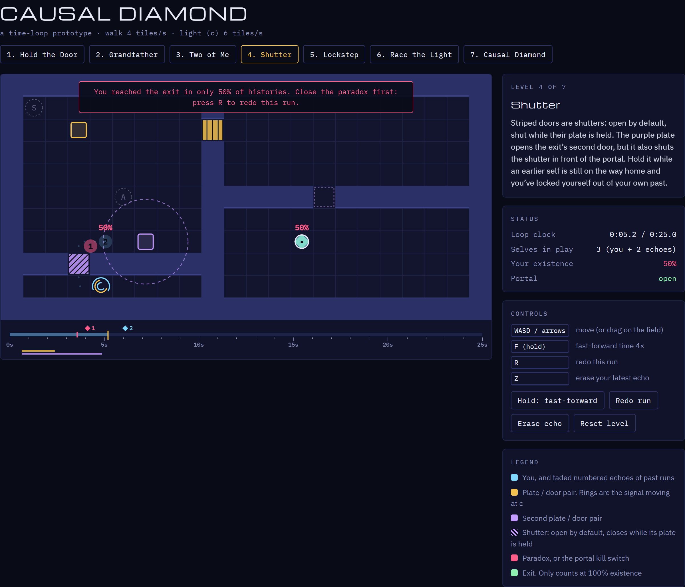

# Causal Diamond

A real-time time-loop puzzle prototype. Your past selves replay your earlier runs, signals travel at the speed of light, and paradoxes don't end the game. They turn into 50/50 superpositions.





## Play

Open `index.html` in a browser. It's a single file with no build step and no install. It loads its fonts from Google Fonts, and falls back to system fonts when offline.

A welcome panel opens first. The **Info** button in the header explains the physics behind the game, with links for further reading.

## How it works

- **Real-time loop.** Each level runs on a clock (20–30 seconds). The clock starts when you first move.
- **Time portal.** Stepping into the portal rewinds the world to 0:00. Your run becomes a numbered *echo* that replays exactly what you did while you play alongside it.
- **Light-speed signals.** Pressure plates emit visible rings at 6 tiles/s, and a door only reacts when the ring reaches it. You walk at 4 tiles/s, so you can never outrun your own signal. Everything you can influence stays inside your light cone (the "causal diamond").
- **Paradoxes are superpositions (after David Deutsch's model).** If you stop an echo from reaching the portal, for example by closing a door on it or destroying the portal, that echo never travels back. Everyone after it drops to **50% existence** and flickers. The exit only accepts you at 100%, so you have to make the timeline consistent (the Novikov self-consistency principle).
- **No escaping before the damage lands.** When you reach the exit, the game plays out the rest of the loop without you. If any past self would still be stranded later, the exit stays shut.
- **Shutters** (striped doors) are the reverse of normal doors: open by default, closed while their plate is held. A door that shuts while you're standing in it shoves you back the way you came.

## Levels

Each level adds one idea, and the last one combines them all.

1. **Hold the Door**: introduces echoes.
2. **Grandfather**: the portal's kill switch is on your only path out. Press it too early and you cancel your own past.
3. **Two of Me**: two doors in a row. Use two echoes, or one with perfect timing.
4. **Shutter**: the plate you need also shuts the portal's door, so it's about the order in which your selves act.
5. **Lockstep**: two side-by-side doors need both plates held at once, and the first self has to stay put until the shutter on the way home reopens.
6. **Race the Light**: the kill switch's signal takes 2.6 s to reach the portal. Your past self has to get home inside that window, and you have to get through the door before it closes.
7. **Causal Diamond**: lockstep doors, a shutter and a kill switch together. Plan the first run before you move.

## Controls

| Input | Action |
| --- | --- |
| WASD / arrow keys | Move (or drag on the field on touch screens) |
| F (hold) | Fast-forward time 4× |
| R | Redo the current run |
| Z | Erase your latest echo |

The timeline under the field marks when each echo enters the portal (diamonds), when a paradox happened (red marks), and when each plate was held (colored strips).

## Tests

The simulation lives in its own `<script id="engine">` block with no page dependencies, so it can be tested in Node:

```
node tests/verify-levels.js
```

This plays a scripted reference solution for every level (`tests/solutions.js`, which contains spoilers) and checks that each one wins. It also checks that walking straight to the exit never wins, and that the obvious mistake on each paradox level gets blocked.

The screenshots are captured by letting the same autopilot play in Chrome:

```
npm i playwright-core
node tests/screenshot.cjs "C:/Program Files/Google/Chrome/Application/chrome.exe"
```

## Status

Prototype. Seven levels, no save state, and built mainly for keyboard play. Ideas for a bigger 2D/3D version:

- Show both branches of a superposition at once.
- Add puzzles where you create a paradox on purpose and then resolve it.
- Add a black hole level where space and time swap roles.
- Add a 3D view with time as the vertical axis, so your worldlines are visible.

## Further reading

- Kip Thorne, *Black Holes and Time Warps*
- J. Richard Gott, *Time Travel in Einstein's Universe*
- David Deutsch, *The Fabric of Reality*
