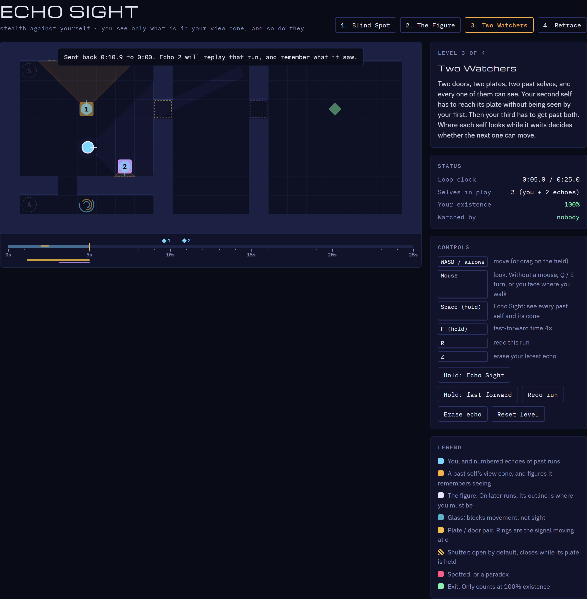
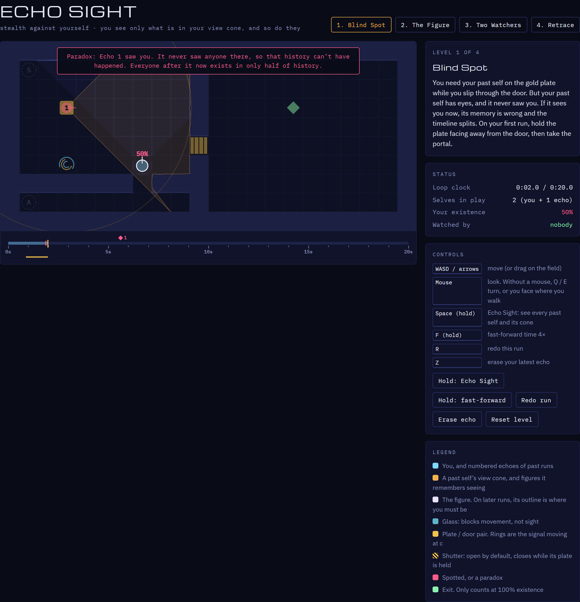
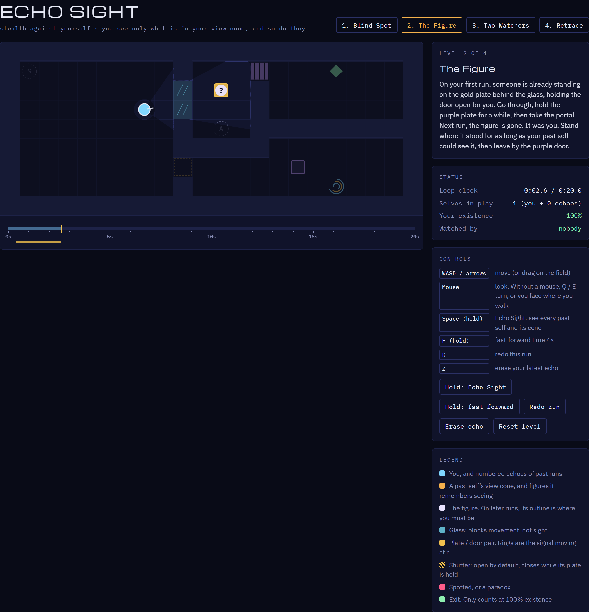

# Echo Sight

Stealth against yourself. A 2D test bed for a first-person time-loop game: you only see what's in your view cone, and so does every past self. Your past selves remember exactly what they saw, so you must never be seen where they saw no one, and you must be wherever they saw someone.







## Play

Open `index.html` in a browser. It's a single file with no build step and no install.

## The rule

**Every past self must see exactly what it remembers seeing.**

- **Seeing your past self is safe.** It replays exactly, so your memory of it will always hold.
- **Being seen is not.** If a past self sees you where it remembers no one, it has been *spotted*, and the timeline splits. Every past self's view cone is always shaded on the floor in amber, even when you can't see the self (your own cone is blue). Echoes replay exactly, so the game also warns you: a past self's cone pulses red, and so does the board's edge, when it will see you within 0.8 s if you stay where you are.
- **The figure.** On some levels, your first run shows a stranger already there. On later runs it's gone, because it was you. Stand where it stood while your past self could see it.

Paradoxes work as in [Causal Diamond](../causal-diamond/): every self after a broken one exists in only 50% of histories, and the exit only accepts 100%. When you reach the exit, the game plays out the rest of the loop without you. If any past self would still be spotted, miss a prophecy or get stranded, the exit stays shut.

See [DESIGN.md](../DESIGN.md) for the full rules and the plan for the first-person game.

## Levels

1. **Blind Spot:** where you look on your first run decides whether your second run can get through unseen.
2. **The Figure:** someone holds the door for you. Next run, you become them.
3. **Two Watchers:** three selves, two of them watching. Each has to slip past the ones before it.
4. **Retrace:** the figure, glass you can be seen through, and a shutter on your past self's way home.
5. **Footsteps:** the figure walks to the plate, stopping on the way. Next run, walk where it walked, when it walked.
6. **Two of Them:** the figure holds one plate, steps into the portal, and someone else is already on another. Two figures, so two later selves.

## Controls

| Input | Action |
| --- | --- |
| WASD / arrow keys | Move (or drag on the field on touch screens) |
| Mouse | Look. Without a mouse, Q / E turn, or you face where you walk |
| Space (hold) | Echo Sight: see every past self, its cone, and the figures it remembers |
| Any key / click | Start the clock (so a run can begin by waiting) |
| F (hold) | Fast-forward time 4× |
| R | Redo the current run |
| Z | Erase your latest echo |

## Tests

```
node tests/verify-levels.js
```

This plays a reference solution for every level (`tests/solutions.js` contains spoilers), checks that walking straight to the exit never wins, and checks that the obvious mistake on each level is caught. Screenshots come from the same autopilot playing in Chrome: `npm i playwright-core`, then `node tests/screenshot.cjs`.
